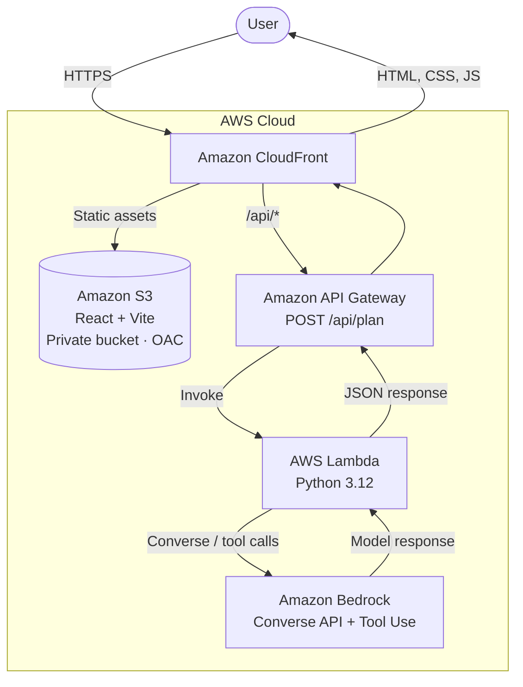

# Cloud Project Planner Agent (Nimbo)

An agent that turns a software idea into a **concrete technical plan on AWS**: services with the reasoning behind each one,
a request flow, a roadmap, cost estimates, risks, and one small first step you can take today.
Built for developers and students. Nimbo, the agent's persona, tailors every plan to your **experience level** and **budget**.

## Architecture



| Layer | Technology |
| --- | --- |
| Frontend | React + Vite + TypeScript, Chakra UI, lucide-react icons |
| Hosting | Private S3 bucket + CloudFront (same domain for web and API: no CORS) |
| Backend | API Gateway REST + Lambda (Python) |
| Generative AI | Amazon Bedrock (Converse API, structured output via *tool use*) |
| IaC | AWS CDK in TypeScript |

## Experience details worth trying

- **Friendly first run:** Nimbo greets you, example ideas fill the form in one tap, and the character counter guides instead of blocking.
- **Waiting with personality:** rotating status messages while Bedrock works, plus a cancel button.
- **Helpful errors:** every failure (no model access, throttling, timeout, idea too short…) explains what happened and offers *Retry* or *Edit my idea*.
- **Actionable output:** copy or download the plan as Markdown with a task checklist.
- **Accessible:** focus moves to the plan title, `aria-live` regions, and `prefers-reduced-motion` is respected.

## Requirements

- Node.js 20+, Python 3.12 (tests only), AWS CLI configured with permissions to run CDK.
- An AWS account in **us-east-1** (or us-east-2 / us-west-2).
- Access to a model in Amazon Bedrock. The default is **Amazon Nova Lite** (`us.amazon.nova-lite-v1:0`).
  If you see "Bedrock model access needed", check *Bedrock → Model access* in the console.

## Deploy

```bash
# First time only, per account/region
cd infrastructure && npm install && npx cdk bootstrap && cd ..

./deploy.sh
```

When it finishes, you'll see `SiteUrl`. To tear everything down: `cd infrastructure && npx cdk destroy`.

### Use a different model

```bash
./deploy.sh -c modelId=us.anthropic.claude-3-5-haiku-20241022-v1:0
```

Any Bedrock model that supports Converse and tool use will work (enable its access first).

## Local development

```bash
cd frontend && npm install
VITE_API_TARGET=https://dxxxx.cloudfront.net npm run dev   # proxies /api to your deployed stack

cd backend && python -m unittest discover -s tests          # validation and normalization tests
```
